<p align="center"></p>
<h1 align="center">A little space to create.</h1>
<p align="center">A local visual design studio for invitations, brand stories, presentations, data, and ideas.</p>
<p align="center"><a href="#download-the-desktop-app">Download & setup</a> · <a href="#take-a-tour">Walkthrough</a> · <a href="#try-an-example">Editable demos</a> · <a href="docs/ROADMAP.md">Roadmap</a></p>

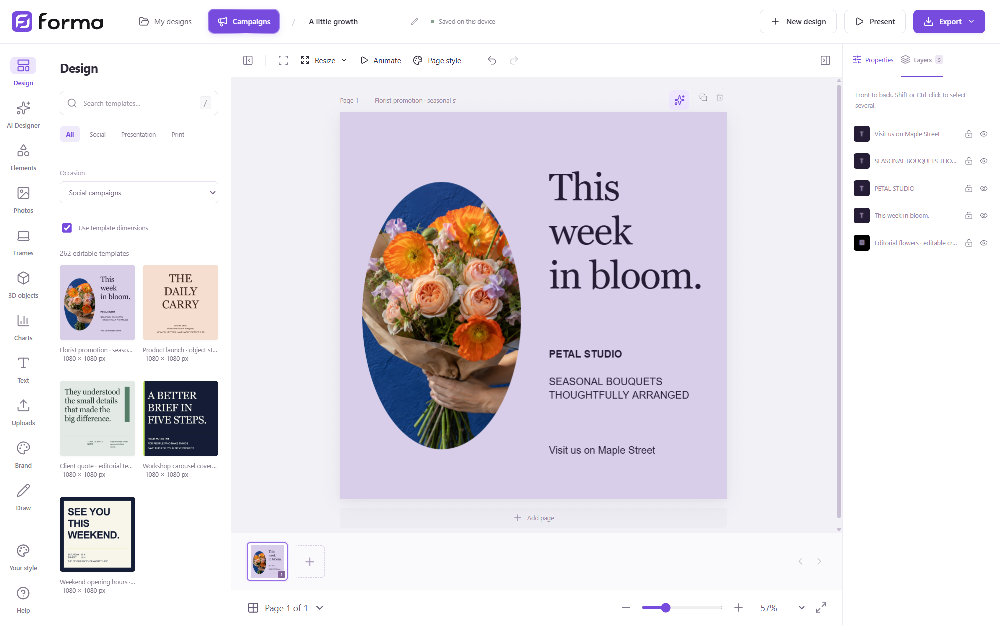

Build with draggable layers, original artwork, photo-filled letters, editable charts, and AI refinement. Save on your device, run the app with Docker, and export still images or motion. These screenshots show the actual editor in an isolated test profile; the example projects are editable Forma files.

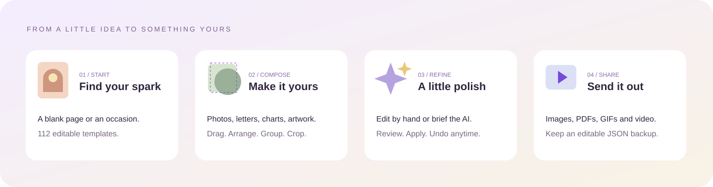

## What you can make

| Design                                                                                                     | Compose                                                             | Refine                                                                 | Share                                                    |
| ---------------------------------------------------------------------------------------------------------- | ------------------------------------------------------------------- | ---------------------------------------------------------------------- | -------------------------------------------------------- |
| **262 reworked editable templates**                                            | **304 transparent AI stickers**, **290 editable graphics**          | AI Designer, selection refinement, AI Pencil, and Magic Eraser         | PNG, JPG, SVG, PDF, editable JSON, GIF, WebM             |
| Birthdays, weddings, seasonal events, business, retail, hospitality, wellness, education, and celebrations | 250 graphics across 25 brand collections; four original Forma fonts | Groups, alignment, gradients, transparent stops, crop, corner rounding | Multiple pages, Present, motion previews, local projects |

## Download the desktop app

**Windows is free.** Download [Forma Studio 1.6.1 for Windows](https://tryformastudio.netlify.app/downloads/v1.6.1/Forma-Studio-Setup-1.6.1.exe), run the installer, and open **Forma Studio** from your desktop or Start menu. Windows 10/11, 64-bit. The current installer is unsigned, so Windows may display an unknown-publisher warning.

**Business setup:** In **Your style → Brand & intent** or **Brand**, choose **Enter manually** or **Use my website**. AI drafts the company, business, mission, audience and voice from public pages, with source excerpts and clearly labelled suggestions. Review the draft, choose which fields to fill, then save. Existing values are preserved by default. Your personal design preferences stay separate and combine with the reviewed brand context across AI tools.

**Security:** [Read the security boundaries and verification notes](SECURITY.md). The desktop renderer is sandboxed and isolated; the local AI API checks origins and session tokens. Website drafting validates public network destinations, and the download site serves static marketing content. [Report a vulnerability privately](https://tryformastudio.netlify.app/security/report).

The desktop app bundles the editor, its local worker and Codex CLI. No terminal, Node.js or Docker is required for everyday use. Forma requires no app account or sign-in. Projects save locally; **Export → Forma JSON** creates an editable backup. To move a browser project into the desktop app, export it from the browser and import the JSON file in Forma. Their storage is separate.

**Updates:** Version 1.2 and later check for releases when you are online. Choose **Download update**, then **Save & restart**. You can keep working until you are ready. Help also has **Check for updates**. There is no Forma update server, subscription or customer release-host account. Versions 1.1.x need the current installer once to enable future in-app updates. [Release and minimum-version instructions](updates/README.md) explain how to publish an update and show an **Update required** prompt without locking users out of offline designs.

The new identity has a custom folded F symbol and drawn wordmark, shared across the editor, desktop, installer and website. [Identity files and usage](public/brand/README.md) include the source geometry and the limits of the preliminary name/mark search.

For AI, open **AI Designer → AI account & connection → Sign in to Codex**. Complete the sign-in in your browser and return to Forma. Your existing Codex login is also recognized. AI needs a supported account, internet access and available provider usage; those costs are separate from the app. Manual editing and exports work without AI. Website frames use the bundled desktop browser to capture pages in an isolated session.

The Mac app is **$49 once for one Mac**. The payment and single-device activation implementation is in place, with [setup and verification notes](payments/README.md). Purchasing stays closed until merchant configuration and a signed/notarized Mac installer are ready. There is no verified Mac download in this Windows release.

For developers, `npm run desktop` opens the built desktop app and `npm run desktop:package` builds an installer. `npm run desktop:smoke` checks the app using a separate test profile. Desktop services bind to `127.0.0.1:51860` and `127.0.0.1:51861`; app data and AI job history live in the user's Forma app-data directory.

## Start locally from source

The complete installation has been exercised on **Windows with Docker Desktop and Microsoft Edge**. Install **Node.js 22.12 or newer in the 22.x line**, npm, and Git. Docker Desktop must be running for the complete stack.

### 1. Open a maintainer source checkout

```powershell
cd forma-studio
npm ci
```

### 2. Start Forma

```powershell
npm run local
```

The first start downloads Docker images. The script creates the isolated `forma-local` network, builds the editor container, and starts the local worker in the background. Forma opens without an app account. Open **[localhost:5186](http://localhost:5186)**.

| Service         | Address                | Purpose                          |
| --------------- | ---------------------- | -------------------------------- |
| Editor          | http://localhost:5186  | Design in the browser            |
| Local worker    | http://127.0.0.1:5188  | AI jobs and website captures     |

Use the same browser address consistently: `localhost` and `127.0.0.1` have separate browser storage. The editor binds to this computer's loopback interface.

### 3. Enable AI and captures

Install the [Codex CLI](https://developers.openai.com/codex/cli/), sign in, then start the worker:

```powershell
npm install -g @openai/codex
codex login
npm run ai:start
```

The current capture worker uses Playwright's Microsoft Edge channel. Install Edge if it is unavailable. On Windows, a custom Codex installation can be selected by setting `FORMA_CODEX_BIN` to its `codex.exe` path before starting the worker.

**AI needs internet access and a signed-in provider account.** Localhost keeps the application, documents, and worker on your computer; model inference uses the provider. Briefs and selected images are sent for the requested AI operation. Manual editing and browser saving work without AI.

### Frontend-only development

For editing without Docker:

```powershell
npm ci
npm run dev
```

Port 5186 must be free. If the Docker editor is running, stop that service first with `docker compose stop studio`.

An isolated preview can run alongside the Docker app with `npm run dev -- --port 5190`. The production worker accepts configured local origins on ports 5186 and 5187; other preview origins need deliberate worker configuration. UI tests can use isolated fixture endpoints.

### Update and stop

```powershell
# Rebuild after source changes
docker compose up -d --build

# Stop without deleting saved database volumes
docker compose stop

# Stop the worker after active jobs finish
npm run ai:stop
```

Run `npm run local` to start again. Logs and job files are under `.local/designer.log` and `.local/designer`.

## Campaigns & an AI guide

Open **Campaigns** in the header or **My designs → Campaigns**. The full-screen wizard follows the hierarchy **campaign objective → subcampaign folder intent → platform designs**.

1. Name the campaign, describe its overall objective and audience, and set the visual direction. Your saved brand mission and palette provide context.
2. Give the first folder a name and its own focused intent. Add exact required copy, facts, a call to action, and anything to avoid. Add more folders with **New folder**; each supports the parent campaign.
3. Choose **0–6 designs per format**: Instagram, Facebook, LinkedIn, stories, posters, A4 documents, flyers, yard signs, business cards, square or landscape ads, website banners and presentations. Add up to six named **custom sizes**, with exact whole-pixel dimensions from 256 to 4,096 px per side, up to 12 megapixels. Upload up to four PNG/JPG/WebP images, or reserve one slot for an optional AI campaign photo.
4. Review the brief and press **Create**. The connected local worker creates each format in sequence, carries the first format's palette and typography into the others, and saves every output as a separate editable design in that folder.
5. Open a result to edit its layers. Use **Move to folder** for an existing design. Completed work remains saved if another format fails; **Resume collection** retries unfinished work. **Pause after current format** preserves the current job, and drafts save on this device.

Campaign previews keep the complete artwork inside each card. Portrait, story, square and landscape formats fit above the title; long names wrap without covering the image or dimensions. [See a current editable template collection](docs/media/campaign-modern-v1.5.png).

**AI campaign guide** inside Campaigns explains how to brief a collection. AI uses your own supported Codex account and provider usage. The app itself needs no Forma account. Review generated copy and imagery before publishing.

## Personal design direction

Open **Brand → Set up brand & style**. One three-step guide combines your preferred styles, spacing, typography and color direction with your business, mission and audience. Existing saved brand and style profiles are preserved. Choose up to three styles. In **The details**, select multiple craft preferences and things to avoid, then add your own written notes. Save both profiles together on this device; edit them or disable personal design preferences from this same guide. Logo and palette tools remain in Brand.

The saved profile accompanies AI Designer, campaigns, photo creation, selection refinement, AI Pencil and Magic Eraser. Your current instructions and required brand identity take priority over personal defaults. Pencil matches the existing image inside the mask; Eraser only removes the marked subject and reconstructs the existing background. Campaign batches keep a snapshot of their preferences and exact format dimensions when resumed.

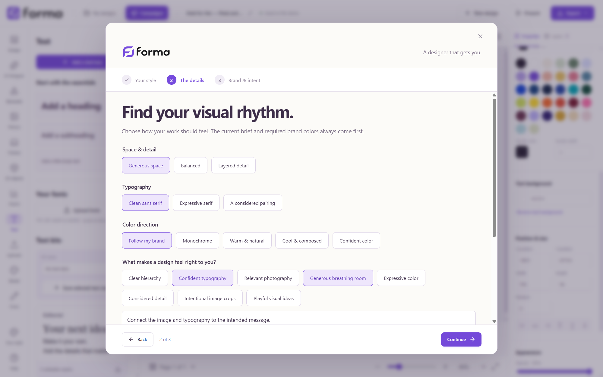

AI work has no six- or eight-minute generation cutoff. It keeps running while the worker and provider remain available; **Cancel** stops the owned job. Temporary status-read failures reconnect to that same job without starting a duplicate generation. Provider or process failures still show an error for review.

## Arrange your pages

Drag a thumbnail along the bottom page strip and drop it at the purple insertion line. Mouse and touch work, and holding near an edge scrolls a long strip. The displayed page stays selected, including its layers and animation. Use **Undo/Redo**, the move arrows, or focus a thumbnail and press **Alt + Left/Right Arrow**. Escape or dropping outside the strip cancels the move. Order saves locally and determines presentation and export order.

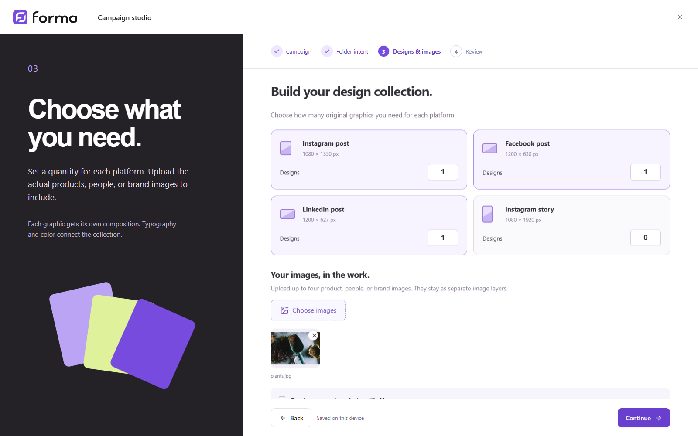

This illustrative gardening campaign was created by the real local worker using **GPT-6 Astra, maximum reasoning**, with the uploaded photograph preserved as an image layer. The three outputs have 8, 11 and 8 editable layers across the requested formats; the screenshots are actual editor renders.

| Instagram | Facebook | LinkedIn |
| --- | --- | --- |
| 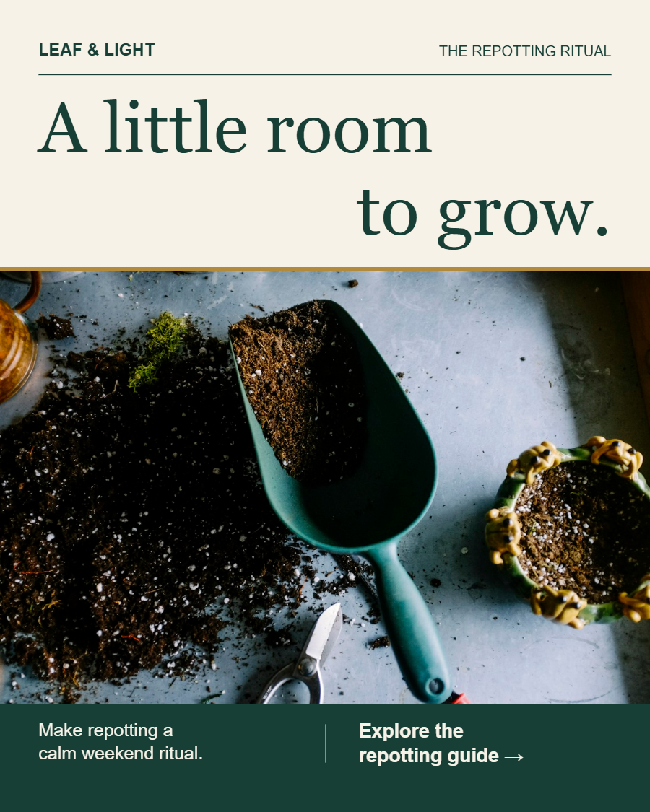 | 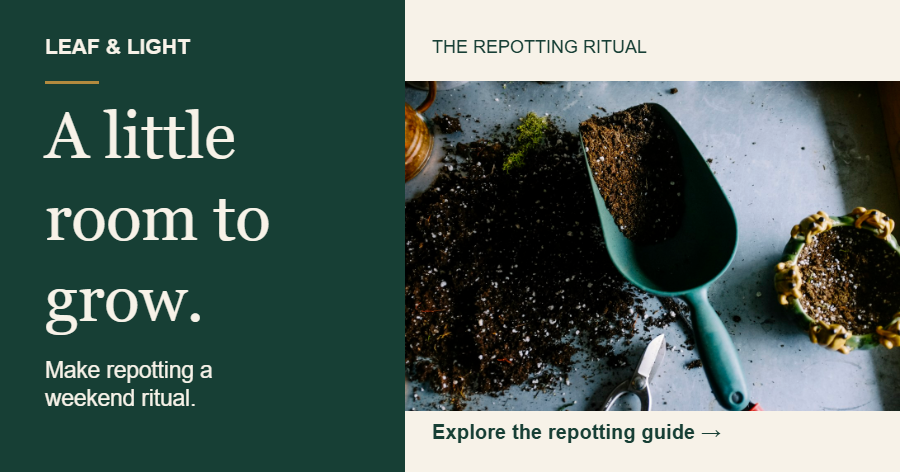 | 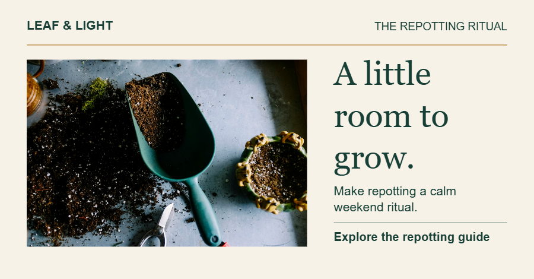 |
| [Editable example](docs/examples/campaign-instagram.json) | [Editable example](docs/examples/campaign-facebook.json) | [Editable example](docs/examples/campaign-linkedin.json) |

## Draw, highlight & erase

Open **Draw** and choose **Pencil**, **Marker**, **Paintbrush**, **Highlighter**, or **Stroke eraser**. Ink tools offer custom colors, your brand palette, size and opacity. Each stroke stays editable and travels with the design. The highlighter starts translucent; the paintbrush has a soft edge. The stroke eraser removes touched freehand strokes, and one Undo restores a whole erase gesture. Press **Escape** to return to selecting.

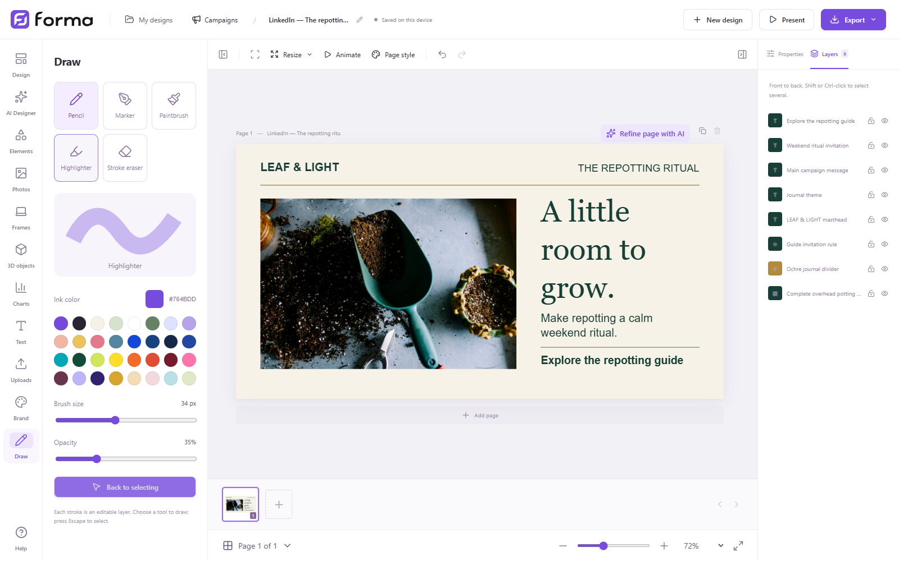

## Take a tour

### 1. Start with a purpose

Open **Design**, choose an occasion, and click a template. Titles, shapes, graphics, and photos remain editable layers. Or choose **New design** for social, presentation, print, or custom dimensions.

The rebuilt collection retains **24 yard signs, 24 business cards, 24 birthday posters, 24 flyers, 24 business-pitch slides**, and **30 menus, invitations, social campaigns, business documents, community and life-event layouts**. The full 262-template library now uses modern editorial layouts, function-specific documents, editable photography, native illustrations, 3D numerals and charts. Original IDs, formats and example facts remain available. Choose **Use template dimensions** to apply the original format to a single-page design; otherwise the template fits your canvas. Six pitch covers offer **Use 4-page deck**. A deck inserts its other pages after the current page, and one Undo restores the previous document. The color picker includes 32 starting swatches plus custom colors.

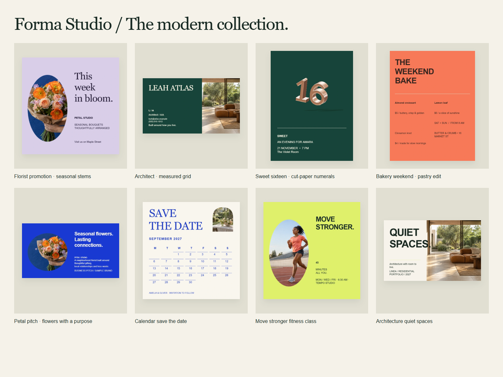

**Modern collection:** 62 templates use photography, 41 use editable photo masks or rounded crops, six have native 3D lettering, and six contain real chart data. [How the library was rebuilt and verified](docs/template-modernization.md).

| Native 3D lettering | Editable chart data |
| --- | --- |
| 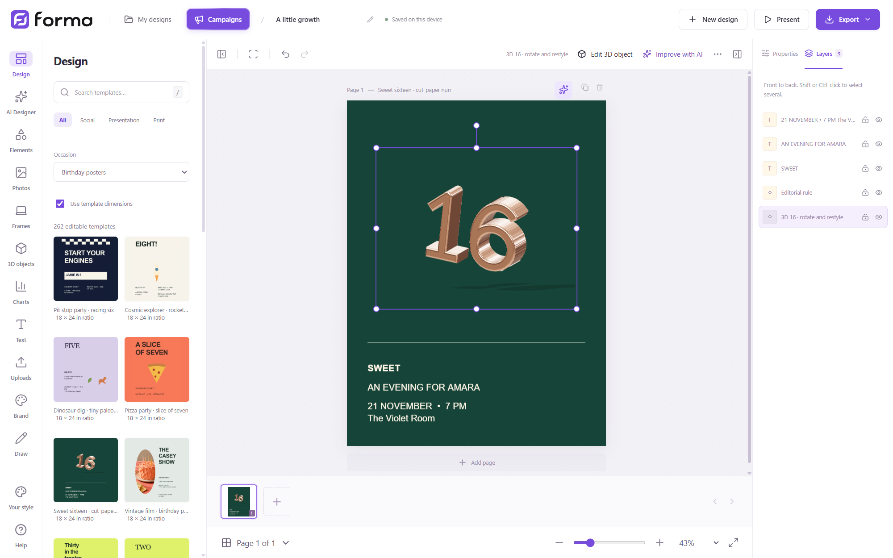 | 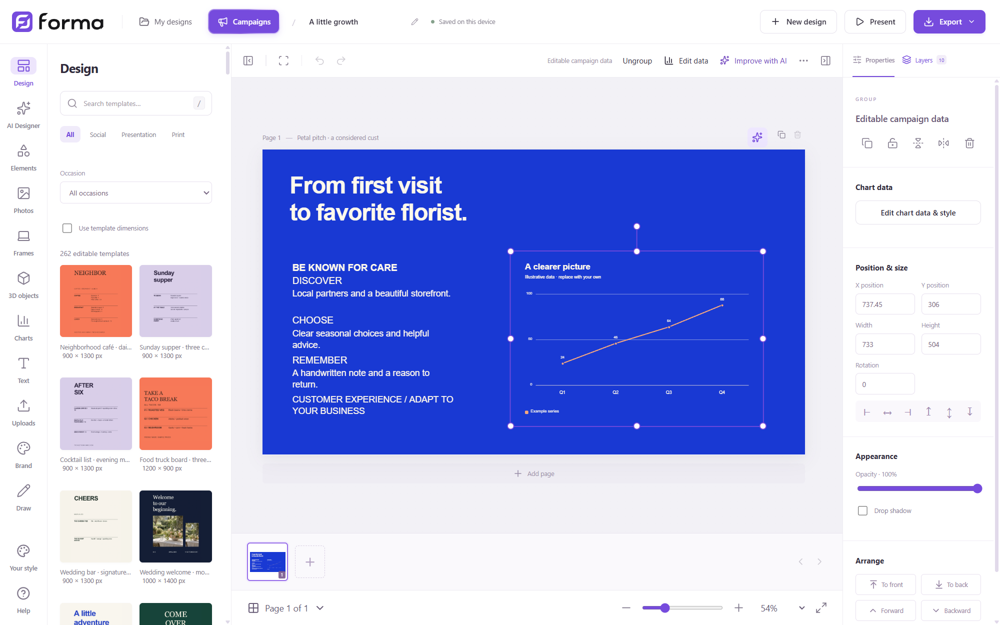 |

Open these editable examples in **Import design**: [florist campaign](docs/examples/modern-florist.json), [3D birthday invitation](docs/examples/modern-birthday-3d.json), [pitch with chart data](docs/examples/modern-pitch-chart.json).

Change the document title in the header. Browser saving happens automatically. Use the page strip, **Add page**, and **Duplicate page** to build a larger document.

### 2. Select and compose

Click to move, resize, or rotate an object. Double-click an element to reveal its Properties panel, even when the panel is collapsed. Drag across empty canvas space to select several objects or groups. Selection can also begin in the surrounding workspace. **Select area** in the top toolbar lets a drag begin over existing artwork. Hold **Shift**, **Ctrl**, or **Cmd** to add to the selection; **Escape** leaves selection mode.

Right-click for selection actions. Use Layers to select/reorder objects, and purple guides for alignment and equal spacing. Zoom with the canvas wheel or footer.

For a rectangle, open **Properties → Appearance → Corner roundness**. Enter a pixel radius or choose **Square**, **Soft**, or **Pill**. Text supports individual word styling; text and vector graphics support gradients and transparent stops.

Select text and open **Spacing** in the top toolbar for line height, letter spacing and alignment. Under **Text → Your fonts**, upload TTF, OTF, WOFF or WOFF2 files. They are saved on this device and embedded in Forma JSON and SVG exports when used. **Text kits** saves a selected text style, inserts reusable editable heading/body combinations, and imports or exports kits with their fonts. Font files must be under 8 MB each; the local library holds up to 48 fonts.

**Page style** previews palette and layout-spacing changes on the actual page. It preserves locked content and photos, applies changes as editable objects, and supports Undo. **Refine page with AI**, beside the page's duplicate/delete buttons, captures all visible page layers into the normal refinement preview. Unlock locked content before refining the entire page.

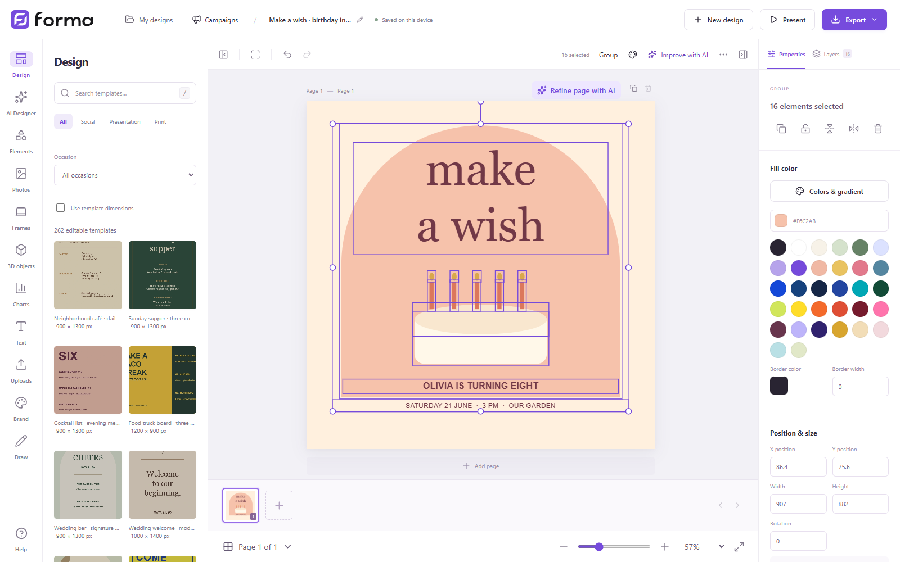

### 3. Add artwork

**Elements** contains stickers, shapes, and vectors. Filter graphics by brand collection or enable **Use my brand palette**. Upload your exact logo under **Brand** for AI-designed artwork. Uploaded photos remain in **Uploads**.

Under **Brand → Your business & mission**, save your company name, business purpose, mission statement, audience and visual voice. AI Designer, refinement, AI Pencil, Magic Eraser and photo creation receive this profile when **Use brand context** is checked. Your explicit request takes priority. Erasing still removes the marked object and restores its surroundings; it does not add brand decorations. Elements can **Prioritize artwork for my business**, bringing relevant graphics and stickers forward while keeping the full library available.

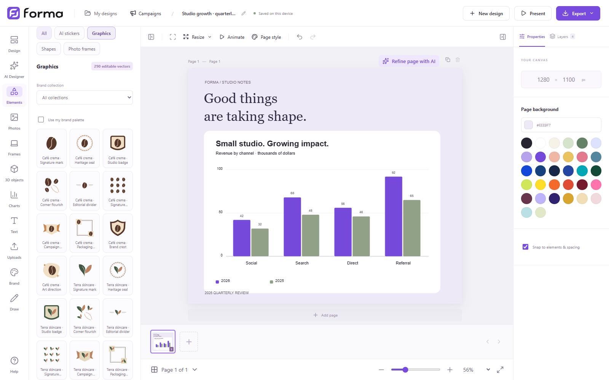

### 4. Fill a letter or shape with a photo

1. Open **Elements → Photo frames**.
2. Choose a shape, alphabet letter, or number. Letter frames offer different fonts and italics.
3. Drag a photo from Photos, Uploads, or your computer onto the frame. Selecting a frame and clicking a library photo also fills it. Existing canvas photos can be dragged into a frame.
4. Double-click the frame or choose **Crop photo frame**.
5. Drag to reposition, adjust crop zoom, change the shape/font, or type a short word, then save.

The image and crop settings remain editable after saving. Remove or replace the photo while keeping the frame. Undo restores the previous crop.

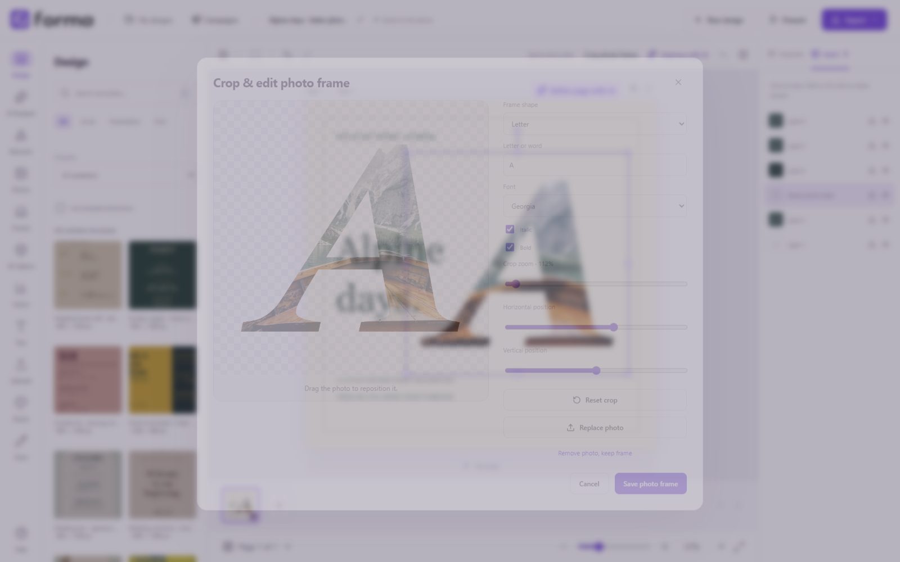

### 5. Tell a story with data

Open **Charts** and choose **Bar**, **Line**, **Area**, **Pie**, **Donut**, **Horizontal bar**, **Stacked bar**, **Radar**, or **Scatter**. Enter values, paste CSV, or import a `.csv` file. Add up to **20 categories and four series** (radar uses 3–12 categories), then edit titles, colors, background, and value labels.

Select the chart and choose **Edit data** to revise it later. Switching styles preserves the dataset. Pie/donut display the first series and require non-negative values with a positive total. Bar, line, area and horizontal bars support negative values; stacked bars accumulate positive and negative values separately from zero. Radar compares non-negative measures on a shared scale. Scatter uses actual numeric X values, with `Label,X,Y` or `X,Y` CSV input. **CSV** downloads the data again, including scatter X values.

```csv
Category,2026,2025
Social,42,32
Search,68,48
Direct,56,46
Referral,92,65
```

Charts render as native canvas groups. Keep the group intact for the data editor; ungrouping exposes the individual artwork.

Use **Hide top bar** in the canvas toolbar for more canvas space. **Show top bar** restores it; **Design actions** keeps your title, projects, campaigns, presentation and export accessible while it is hidden. The AI Designer rail icon shows active design work even when another library panel is open, and stops when that work finishes, fails or is cancelled.

**Campaigns** sits beside **New design**, **Present** and **Export** in the right-hand header actions.

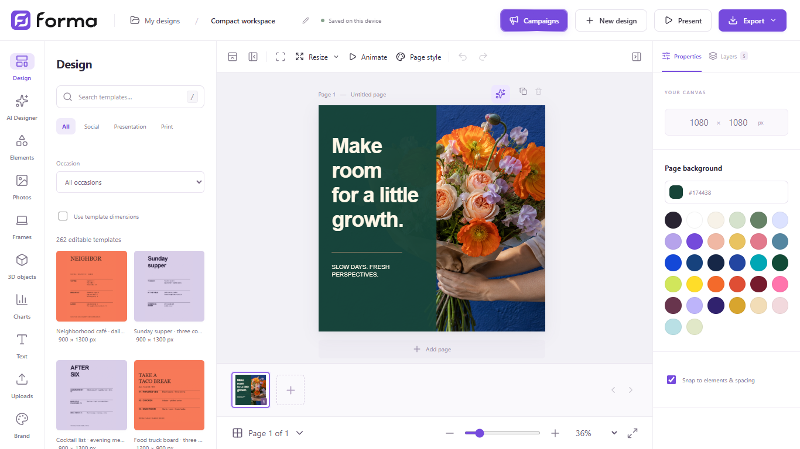

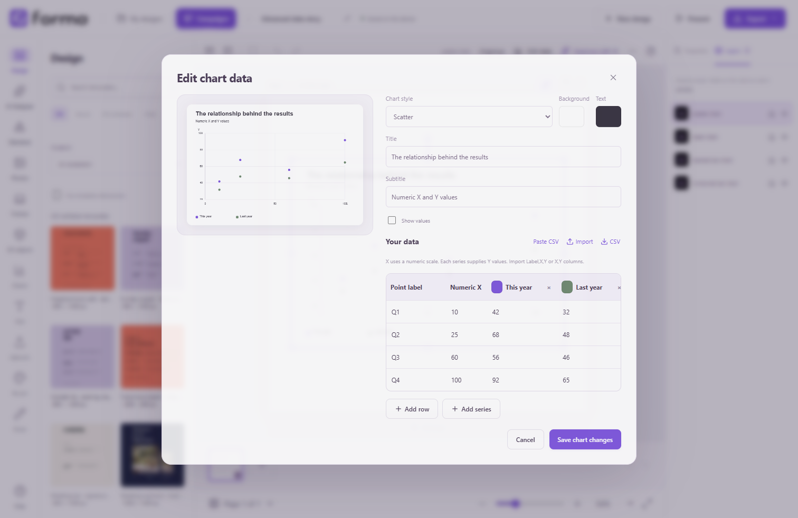

### 6. Refine selected content with AI

Select objects/groups and choose **Improve with AI**. Give a concrete brief and choose **Precise**, **Art directed**, or **Bold redesign**. Compare the selection with the proposed result before applying.

> Add 45 stars throughout this cinema poster. Vary their size and spacing across the top, sides, and bottom. Keep every word and the film frame. Leave the title and small print clear.

Refinement can add separate editable stars, sparkles, shapes, paths, or text. It validates element geometry and explicit numeric star requests. Existing groups and unselected artwork are preserved; one Undo restores the original. Short design notes explain the visible decisions. Review the AI's work before applying.

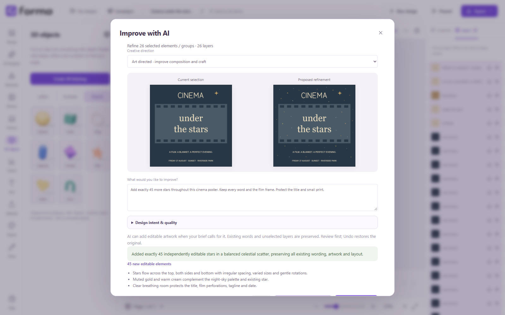

Use **AI Designer** for a new editable composition and **Photos → Create with AI** for a new image.

The designer now studies credited Dribbble references, develops three original concepts from your intent and brand mission, and critiques the actual rendered result. Open **Design direction & review** to inspect the concept, sources and review status. [How research and rendered review work](docs/design-quality.md).

New campaigns use a palette you have actually saved or let the director choose from the brief; **Use my brand palette** makes the choice explicit. To put a color behind selected text, open **Properties → Text background**. Add, recolor or remove it independently of the text color; it persists in saved designs and exports.

Open **Design intent & quality** to specify the desired outcome, main message, what must remain unchanged and what to avoid. These instructions reach AI Designer, photo creation, selected-layer refinement and AI Pencil. The designer resolves a reading order from the current request, campaign/folder objective, brand purpose and compatible taste. It is instructed to connect typography and imagery to that job and use supporting elements only when they help communication, grouping or readability. Its review receives the complete commission and both full-page and reduced previews. A craft correction sees the actual page it is fixing and preserves successful parts of the composition. Magic Eraser stays focused on restoring the marked area. The brief and selected region take priority over inferred style.

The local worker explicitly uses **GPT-6.1 Sol with maximum reasoning** through Codex CLI. This shared setting applies to design research, art direction, composition, rendered review, campaigns and image tools. Image creation and editing use **Codex native image generation**; the CLI does not expose a separate image-model identifier here. The model name shown in the UI comes from the running worker. Guidance improves the brief, but every AI result still needs review.

To design around an existing photo, select it and choose **Design with this image** in Properties or the right-click menu. **Keep image quality** is the default: the actual original is embedded as a photo layer, with new text, logos and layout elements on separate layers. This avoids rebuilding photographic subjects out of primitive shapes. Use AI Pencil for targeted changes within the photo. **Rebuild simple artwork** remains an explicit option for flat posters and simple graphics; it is a stylized approximation and cannot recover hidden original layers. Completed jobs retain the embedded photo and exact logo when reopened or refined.

### 7. Make a targeted change with AI Pencil

Select a photo or background image, then choose **AI Pencil** in the toolbar, properties, or right-click menu. Mark the desired area with **Circle an area**, **Freehand outline**, or **Paint an area**. Describe the change, including direction, scale, or details that matter.

> Add a shark swimming left in this area. Match the ocean illustration's teal colors, flat shapes, gentle lighting, and scale. Keep the sailboat and everything outside the marked area.

The original image supplies context and style; your mask supplies location. Select **Generate targeted edit**, review the before/after result, then **Apply targeted edit**. Clear/undo marks to refine the target or try again. Masked compositing preserves pixels outside the marked area in the working image, and Undo restores the original layer. Mark enough room for the new subject and its local shadows or wake.

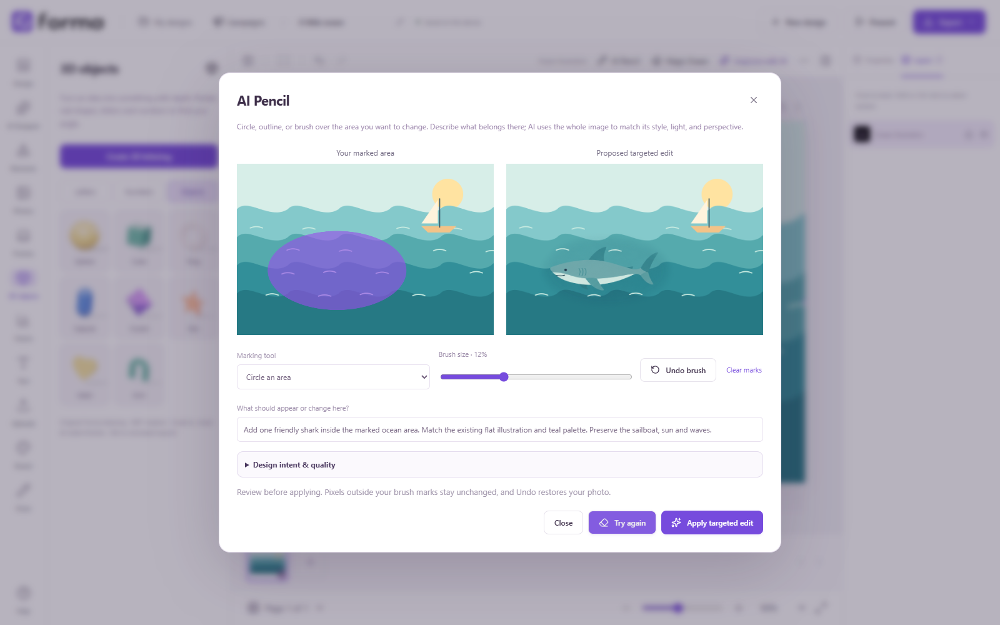

**Magic Eraser** uses the same review-and-apply workflow to remove a painted object and reconstruct the background. AI Pencil and Magic Eraser currently operate on one selected raster image at a time.

### 8. Present a website inside a device

Choose **Frames**, then MacBook, Laptop, iPad, Tablet, or iPhone. Enter an HTTP(S) URL and select **Render website**, or upload a screenshot. Choose a finish, adjust horizontal/vertical perspective, and add Orbit, Rock, or Float movement. **Edit frame** refreshes or replaces the screen later.

Laptop frames use a hinged screen and a solid keyboard base with keys, trackpad, ports and depth. Drag the preview to rotate, choose a view preset, or adjust **Laptop screen opening**. A software renderer retains the same geometry when WebGL is unavailable. The dialog keeps its save controls accessible on smaller screens.

<table><tr><td width="50%">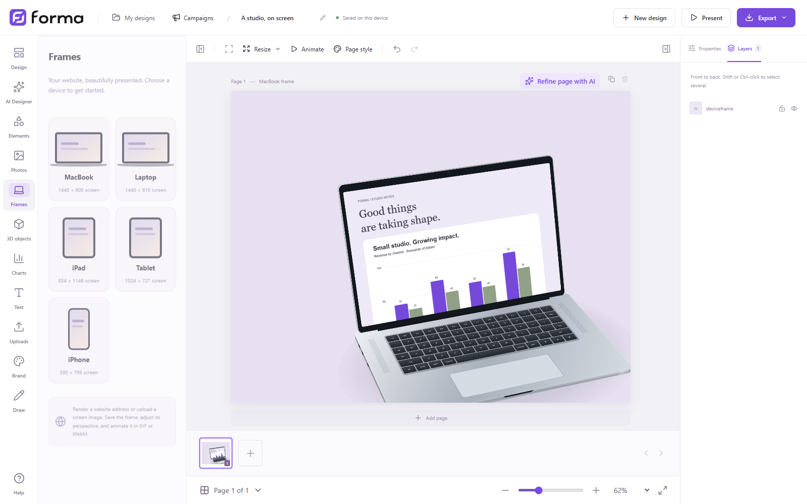</td><td width="50%">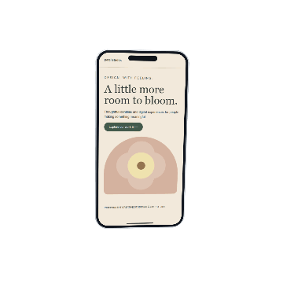</td></tr></table>

Frames save a website capture; they are not interactive browsers in the artwork. Reopening does not fetch the site again. Captures use a fresh session, so protected pages may show login; upload a screen image when needed. GIF/WebM include motion, while PNG/PDF/SVG retain the chosen static pose.

### 9. Add real 3D lettering and objects

Open **3D objects** for 26 letters, 10 numbers and eight shapes. Choose a starting point, type up to 16 characters, select an original Forma letterform, and adjust depth, bevel, color and material. Drag the preview to rotate, use its arrow keys, or enter X/Y/Z degrees. **Front** and **Three-quarter** provide useful starting views.

Add the object, then double-click it or choose **Edit 3D object** to change it later. Geometry settings remain editable in saved projects and Forma JSON; Undo restores earlier settings. Choose **Full turn** or **Gentle rotation** for Present and GIF/WebM exports. PNG, PDF and SVG use the current static pose; SVG embeds a rendered image of the 3D object. All geometry and font outlines are bundled for offline use. A software fallback preserves the shape when WebGL is unavailable, with simpler lighting.

The regular canvas rotation handle also shows live degrees while you drag it.

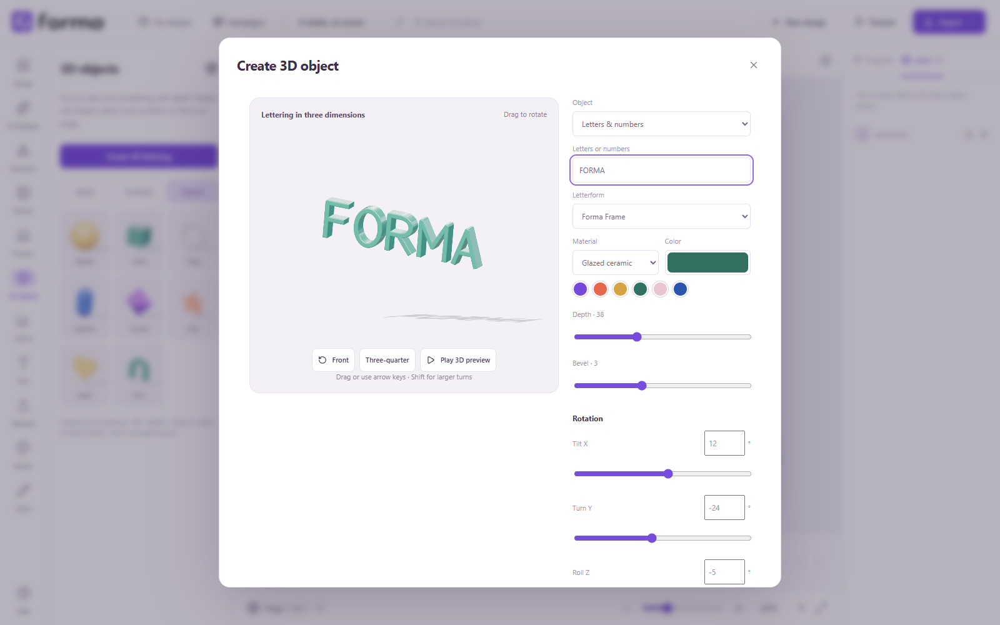

### 10. Save and export

Use **Animate** or **Present** to preview movement. Export PNG, JPG, SVG, PDF, JSON, GIF, or WebM. Motion renders an independent copy and keeps the source unchanged. SVG embeds bitmap and font assets; custom photo/device frames are rendered images within the SVG.

Browser designs, uploads, and brand settings live in IndexedDB for the current origin. **Export JSON for a portable editable backup.** Desktop exports use the native Save dialog; the app saves pending changes before closing. Clearing browser or app data removes local work that has not been backed up.

## Try an example

Save a sample JSON file, then drag it onto Forma. All three are original editable samples.

| Birthday invitation                                     | Quarterly report                                     | Photo-filled letter                                        |
| ------------------------------------------------------- | ---------------------------------------------------- | ---------------------------------------------------------- |
| 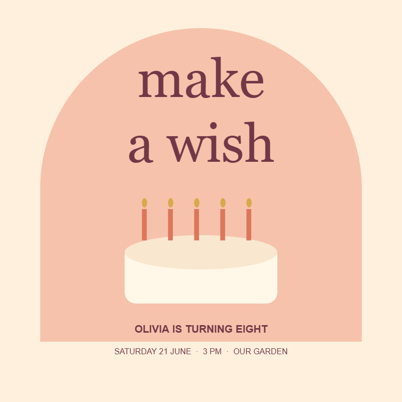 | 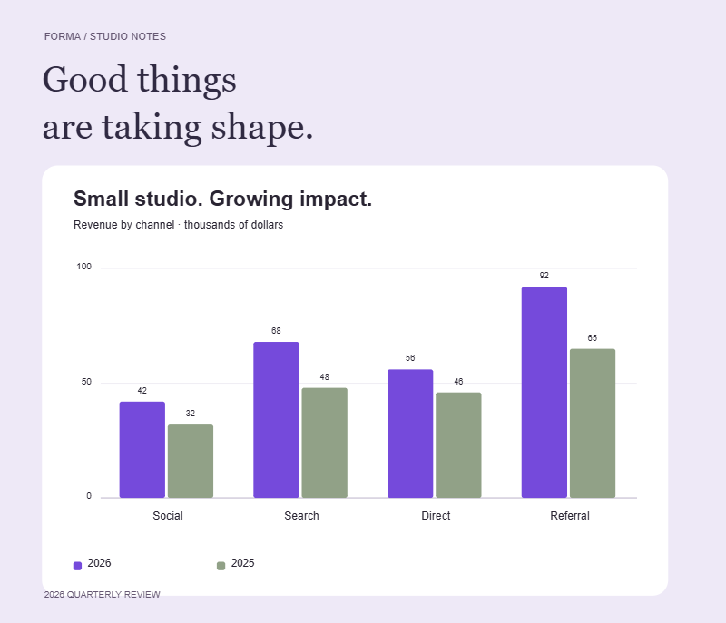    |  |
| [Download JSON](docs/examples/birthday-invitation.json) | [Download JSON](docs/examples/quarterly-report.json) | [Download JSON](docs/examples/alpine-photo-frame.json)     |
| Edit the name, date, colors, and illustration.          | Select the chart and edit its data.                  | Change the A's photo, crop, font, or letters.              |

## Project map

| Location                                             | Responsibility                                         |
| ---------------------------------------------------- | ------------------------------------------------------ |
| `src/editor.ts`                                      | Canvas operations, history, selection, save/export     |
| `src/charts.ts`, `src/ChartDesigner.tsx`             | Charts, CSV, and data editor                           |
| `src/photo-frame.ts`, `src/PhotoFrames.tsx`          | Shape/letter masks and cropping                        |
| `src/device-frame.ts`, `src/Frames.tsx`              | Device mockups and perspective                         |
| `src/solid-object.ts`, `src/solid-renderer.ts`, `src/Solids.tsx` | Editable 3D geometry, rendering and controls |
| `server/art-direction.mjs`, `src/DesignIntent.tsx` | Outcome-driven AI guidance and user constraints |
| `desktop/`, `scripts/package-desktop.mjs` | Desktop startup, native export, capture and packaging |
| `src/refinement.ts`, `server/refinements.mjs`        | Selected-layer AI edits and additions                  |
| `src/MagicEraser.tsx`, `server/pencil-direction.mjs` | Masked erasing and contextual AI Pencil edits          |
| `server/designer.mjs`                                | Loopback worker, authenticated jobs, origin checks     |
| `shared/`, `public/`                                 | Catalogs, contracts, original artwork, fonts, previews |
| `supabase/`, `tests/`                                | Database configuration and regression checks           |

The app uses React, TypeScript, Vite, Fabric, Node, Playwright, nginx/Docker, and Supabase. Netlify publishes the static download landing page in `website/`, using `netlify.toml`; it does not publish the editor's `dist/` directory. Visitors download the desktop software. The editor and AI worker run on the customer's computer.

To update the Netlify landing page from the Forma marketing checkout, run `node scripts/sync-marketing-site.mjs C:/Users/exont/Desktop/forma-studio-site/dist`, then `node scripts/verify-marketing-site.mjs`. Commit the resulting `website/` files. The Netlify build checks the landing entrypoint and assets without building or exposing the application.

## Validation and demo regeneration

Verified on Windows on **2026-10-14**: the production build succeeded, **41 browser tests** and **17 server checks** passed. The optional live import test was skipped in the final regression run. Two separate live GPT-6 Astra design jobs produced an editable florist yard sign and birthday poster with the supplied copy intact. The 3D checks cover editing, persistence, Undo, nonblank renders, motion frames and GIF export; the rotation readout is checked at two zoom levels.

Earlier checks rendered all 150 new template previews without text overflow, retained a supplied photograph and logo byte-for-byte as editable layers, and exercised laptop rotation with WebGL disabled. Real AI Pencil and refinement checks preserved pixels outside the marked region and supported Undo. The scripts and example screenshots below make these checks reproducible.

The **packaged Windows executable** also passed an isolated-profile check: renderer isolation, the bundled Codex worker reporting GPT-6 Astra, website capture, editable 3D, and native PNG/PDF/JSON saves. The landing page was checked at desktop and mobile widths, including filters, image previews and FAQ controls. The Windows installer is unsigned; Mac packaging and payment delivery remain unverified.

With the local editor and worker running:

```powershell
npm run build
npm run test:server
npm test
```

Tests use isolated headless Edge sessions. Coverage includes selection, corners, chart data/CSV, photo frames, masked compositing, AI addition application, assets, rapid zoom, device capture, motion, export, and Undo. Routine AI interaction tests use controlled responses. A completed AI Designer job can be checked by setting `FORMA_AI_TEST_JOB`; otherwise that integration test is skipped.

To regenerate documentation screens, start the Vite preview on 5190:

```powershell
$env:FORMA_TEST_URL = 'http://127.0.0.1:5190'
$env:FORMA_DOCS = '1'
npx playwright test tests/data-design.spec.ts tests/frames.spec.ts
node scripts/build-docs.mjs
```

The following optional checks make real provider requests through isolated test services and retain evidence under `.local`:

```powershell
node scripts/test-creative-refinement-live.mjs
node scripts/test-ai-pencil-live.mjs
node scripts/check-design-quality.mjs
```

## Artwork and scope

Stickers are individual transparent PNGs generated with the built-in image tool. Prompts and provenance live in `shared/sticker-prompts*.json` and `shared/sticker-provenance*.json`. Branded graphics and occasion templates use native editable geometry. The four Forma fonts come from the original geometry in `scripts/build-fonts.py`. Regeneration requires Python with `fonttools` and `skia-pathops`; the script emits both TTF files and bundled Three.js outlines, so 3D text does not need a remote font parser.

Sample photographs in the photo library come from Unsplash. You can replace them with your own photographs through Uploads.

The [roadmap](docs/ROADMAP.md) separates working tools from proposed next features: timeline video/audio, background removal, smart format adaptation, bulk creation, collaboration, and connected data.

## Troubleshooting

| Symptom                        | Check                                                                                                                                |
| ------------------------------ | ------------------------------------------------------------------------------------------------------------------------------------ |
| Port 5186 occupied             | Stop the Docker editor before `npm run dev`, or use preview port 5190.                                                               |
| Docker/Supabase will not start | Start Docker Desktop and retry. Set `FORMA_DOCKER_SUBNET` to a free subnet before initial network creation if the default conflicts. |
| AI unavailable                 | Run `codex login`, start the worker, and inspect `.local/designer.log`. Restart after sign-in once active jobs finish.               |
| Capture fails                  | Confirm Edge is installed and the HTTP(S) page is reachable. Upload a screenshot for protected pages.                                |
| Designs appear missing         | Use the same profile and exact origin. Open My designs on the same device or import a JSON backup.                                                |
| Source changed but app did not | Rebuild the Docker editor, then refresh the browser.                                                                                 |
