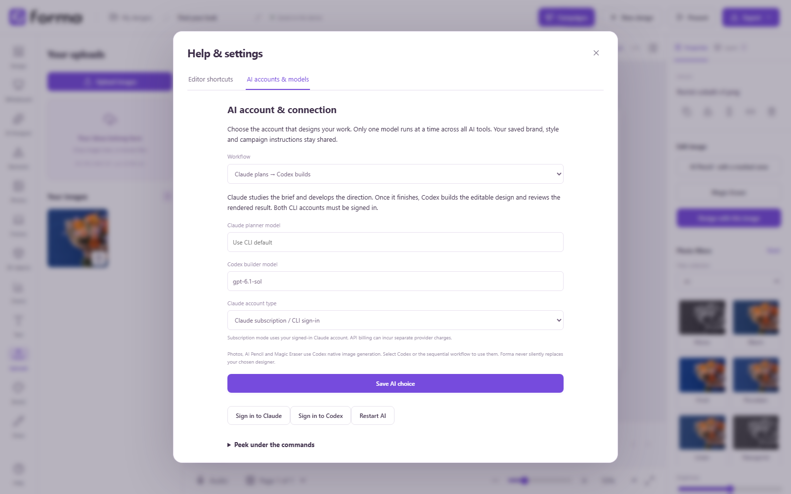

Forma uses the AI CLI installed and signed in on the designer’s own computer. Choose it in **Help → AI accounts & models**, then save the choice. Editing and exports work without AI. Usage follows the provider account’s existing terms and billing method; Forma does not create an API account or store its keys.

The existing brand, personal style, campaign, folder and current request remain the shared source of instructions. Choosing another provider does not ask for another brand profile.

| Choice | Connection | Role |
| --- | --- | --- |
| Codex | Bundled desktop CLI; Sign in to Codex | Editable design, visual review and native image tools |
| Claude | Install Claude Code; Sign in to Claude in Help | Editable design and visual review |
| Gemini | Install Gemini CLI; `gemini` to finish sign-in | Editable design and visual review |
| Kimi | Install Kimi Code CLI; Sign in to Kimi in Help | Editable design and visual review |
| Claude → Codex | Both accounts connected | Claude develops the direction; Codex builds and reviews it |

Leave an optional model field blank to use the selected CLI’s default. Codex retains Forma’s pinned default when blank. An explicit model or alias must exist on that account. The interface distinguishes a detected CLI from a successful provider sign-in; credit, quota and authentication failures appear in the job and its activity record.

One execution gate covers design, photo creation, refinement, Pencil, Eraser and website analysis. Calls wait their turn. The sequential workflow completes each Claude stage before starting Codex; it does not run a hidden parallel team. Provider settings are captured for each job and cannot change while work remains active or queued. Cancel in the tool that owns the job. There is no six-minute generation deadline.

Photo creation, Pencil and Eraser require Codex’s native image tool. Choose Codex or Claude → Codex to use them. Another selected provider is never silently replaced. Claude, Gemini and Kimi receive supplied image attachments for composition and visual review. Their execution adapters disable design-time shell, filesystem and external tool use. Public reference research falls back honestly when live browsing is unavailable.

**Peek under the commands**, in the same connection panel, shows recent jobs, exact submitted creative instructions, local command flags, operational events and results. It is a read-only local activity view; it excludes provider private reasoning and redacts recognizable credentials and attached image payloads. These local logs and CLI account settings are excluded from workspace cloud backups.

Technical references: [Codex non-interactive execution](https://developers.openai.com/codex/noninteractive/), [Claude programmatic usage](https://code.claude.com/docs/en/headless), [Gemini headless reference](https://geminicli.com/docs/cli/headless/), and Kimi Code’s official command and ACP references.

In the desktop app, Help provides **Sign in to Claude**, **Sign in to Codex** and **Sign in to Kimi** for the detected CLI. The sequential workflow shows both Claude and Codex buttons. Complete browser authentication, then choose **Save AI choice**. Signing in preserves unsaved provider and model selections and does not restart an active worker. Gemini uses its CLI's own interactive sign-in.

For Claude, choose **Claude subscription / CLI sign-in** or **API billing / existing CLI environment**. Subscription mode launches `claude auth login --claudeai` and excludes inherited API-key and proxy overrides from later Claude jobs. API mode uses `--console` and the existing CLI environment; it may incur separate provider charges. Existing configurations keep their prior environment behavior until you change the choice. Forma does not silently switch providers after an account or quota error.

