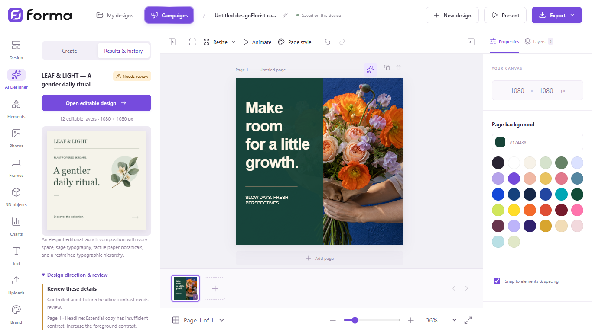

# Forma product review — October 17, 2026

The intent is to improve the existing local desktop product: more intentional AI design results, dependable project recovery, quicker editing and clearer workflows. The current editor, customer artwork, brand identity and campaign hierarchy remain the starting point.

This review inspected the current 1.6 source, a production build in an isolated Edge profile, and the editor at 1440 × 900, 1366 × 768 and 1024 × 768. It did not modify customer projects or submit paid AI generations. A controlled AI-result fixture tested how the interface handles a critical review finding; it does not establish the artistic quality of generated work.

## Findings addressed in this pass

| Finding | Reproduction | Change |
| --- | --- | --- |
| AI completion could look like approval | A completed result carrying `needs-attention` and a critical issue displayed a green **Ready** badge. Its review details were closed and the issue was invisible. | The result now says **Reviewed**, **Needs review** or **Not reviewed**. Findings and unavailable reviews open automatically. The report shows every issue instead of truncating the list to four. Results remain editable. |
| Each edit encoded the thumbnail twice | Clearing a title and typing 22 characters caused 23 immediate document writes and 46 canvas captures. `commit()` captured the page, then `save()` captured it again. | Commit now persists its already captured state. Explicit Save still captures the current page. Saving remains immediate; no new delay or generation deadline is introduced. |

The rebuilt production run recorded **23 captures and 23 immediate saves** for the same action, with no runtime errors. This is a 50% reduction in thumbnail captures for that action; it is not a claim that the whole editor is twice as fast. The critical review fixture now displays **Needs review**, opens its report and exposes the finding.

Evidence: [`Editor.commit/save`](../src/editor.ts), [`DesignerPanel`](../src/DesignerPanel.tsx), [`DesignEvidence`](../src/CreativeDirection.tsx), the [before/after measurements](product-review-evidence.json), and the user-action regressions in [`product-quality.spec.ts`](../tests/product-quality.spec.ts). Twenty-seven relevant browser checks passed; the optional live-generation case was skipped. These cover editing, selection, page ordering, undo/redo, reload, exports, review states and storage failure. Two existing tests were updated for the deliberately modernized default template's actual photo and headline instead of its previous layer count/name.

## Recommended build order

These are proposed improvements, not a list of shipped capabilities.

### 1. Let the AI use more of the editor's actual craft

**Evidence:** [`contract.mjs`](../server/contract.mjs) permits only text, rectangle, ellipse, triangle, line, asset and graphic elements. Text has normal/bold weight and no line-height or letter-spacing controls. [`proposalToDesign`](../src/ai.ts) fixes line height to 1.12. The editor already supports richer type, gradients, photo masks, charts and native 3D; the modern template builder uses several of those capabilities.

This capability gap constrains what the AI can produce; it does not establish why any particular design looks weak. Composition, relevance and typography must be judged on actual rendered examples.

**Build:** Extend the validated design contract incrementally with intentional typography controls, gradients and supported photo masks first, using the visual benchmark to choose what matters. Follow with groups, real chart data and optional native 3D when relevant to the commission. Pass the user's uploaded font choices through a bounded font manifest. Keep the existing simple documents compatible and keep output editable; do not accept arbitrary executable markup.

**Verify:** Use a varied set of real briefs and inspect the editor's rendered output at full size and thumbnail size. Include quiet typography, expressive retail, a photographic campaign, business documents and print work. Test each new capability through save, undo, reload and export. Compare alternatives blind against the same brief; the AI's own review is not proof of professional quality.

### 2. Turn the reviewed brief into testable production requirements

**Evidence:** The pipeline validates dimensions, page count, supported assets and required logo/image use. The rendered AI reviewer checks copy and preservation in prose, but the document contract does not contain a customer-approved list of exact copy blocks or protected element IDs.

**Build:** A compact, editable commission summary should identify the outcome, audience, exact facts/copy, required assets and what must stay unchanged. Validate those requirements before presenting a proposal and after a refinement. Surface a failed requirement with its page and affected element; retain the last usable version.

**Verify:** Exercise exact dates/prices/names, missing facts, protected logos and a narrowly scoped refinement. Check both literal content and actual rendered legibility. Do not silently rewrite the user's supplied facts to make the layout fit.

### 3. Approve one campaign direction before expanding the collection

**Evidence:** [`campaigns.ts`](../src/campaigns.ts) automatically records the first format's palette, font names and a shortened description as its `system`. Later requests call this an “APPROVED VISUAL SYSTEM” without an explicit customer approval step. The first composition and chosen visual route are not carried as a full approved master.

**Build:** Offer a first-design approval checkpoint, with a clear option to run automatically. Carry the approved concept, exact copy, image treatment, type roles and protected identity into the other requested formats. Recompose for each medium rather than stretching the artboard. Existing campaign → folder → designs organization remains intact.

**Verify:** Produce an Instagram, Facebook and LinkedIn set from the same approved concept. Check identity and offer consistency, medium-specific reading order, deliberate crops and an explicit customer correction that survives every format.

### 4. Make long AI work recoverable across restarts

**Evidence:** The campaign runner persists task IDs and reconnects without resubmitting on transient status errors. However, [`designer.mjs`](../server/designer.mjs) restores completed `proposal.json` files at startup; active jobs and their stage state live in a process-local map. A process restart is different from a temporary polling failure. Each AI service also has its own active-work limit rather than a device-wide resource queue.

**Build:** Save an atomic local job manifest, the reviewed brief, request identity, stage outputs and last successful preview. Resume safe completed stages after restart, and make provider/authentication failures explicit. Add a shared local queue so image generation, composition and browser rendering do not overwhelm a small machine. Do not blindly repeat a paid request whose outcome is unknown.

**Verify:** Interrupt each stage and restart the app. Completed outputs must survive; the UI must explain what can resume and when user action is required. Test cancellation, authentication expiry, rate limits and a lost POST response. There should be no arbitrary six-minute cancellation.

### 5. Reduce the cost of large projects and downloads

**Evidence:** Undo retains up to 50 serialized full-document states, including image data and thumbnails. [`allDesigns`](../src/storage.ts) and [`allCampaigns`](../src/campaigns.ts) read every value in the shared IndexedDB store before filtering. Startup loads the complete design list and all default fonts. The measured initial JavaScript file is 2,186,340 bytes. The current build contains **446,869,493 bytes across 304 sticker images**; the prepared Windows installer is about 689 MB.

**Build:** Deduplicate binary assets, use document summaries for project lists, and bound history by bytes as well as operation count. Group a continuous gesture into one history step. Lazy-load substantial optional panels and only the fonts needed for a document. Measure lossless sticker delivery formats and smaller library previews while retaining transparent original export quality. Preserve immediate-save and close/restart guarantees before introducing any write coalescing.

**Verify:** Benchmark realistic photo-heavy documents and a large project library, including an editing session with many undos. Record memory, interaction latency, database bytes and package size before/after. One initial production run became ready in 1.139 seconds on this machine; that single measurement does not establish a general startup problem or performance guarantee.

### 6. Make the common editing actions easier to find and read

**Evidence:** The laptop walkthrough has eleven primary rail tools; preferences and lower tools need scrolling at 768 px height. Rail labels, template titles/dimensions and save status measured 10 px in the production browser. At 1366 × 768, the canvas stage was 744 × 497 px and its fitted square artwork 387 × 387 px. AI Pencil is available for a selected image, but a new user must first discover that selection-dependent path. No horizontal document overflow was observed at the three tested widths.

**Build:** Give selected photos an obvious contextual entry to AI Pencil and Eraser, with a clear selection hint. Improve primary label size and contrast, keep the most useful canvas space available, and add searchable commands plus consistent keyboard/focus behavior. Keep secondary instructions concise.

**Verify:** Time first-use tasks with someone unfamiliar with Forma: find a template, replace its photo, use Pencil, refine a group, locate a campaign output and export. Audit contrast, zoom, keyboard focus and target spacing separately. [WCAG 2.2 target-size guidance](https://www.w3.org/WAI/WCAG22/Understanding/target-size-minimum) is a useful reference; small text alone is not evidence of a specific WCAG failure.

### 7. Add workspace recovery and production-aware export

**Evidence:** Forma JSON backs up an individual document, while campaign organization, saved brand, uploaded library and text kits live in separate stores. Undo history is in memory. PDF currently embeds a rendered PNG for each page; it is not a verified vector, bleed or color-managed print workflow.

**Build:** Add a portable whole-workspace backup, automatic local revision snapshots and a tested restore flow. Show storage health and request persistent browser storage where supported, without presenting it as a backup. For business cards, signs and flyers, add physical units, effective image resolution, trim/safe-area guidance and explicit bleed settings. Describe the PDF's actual production limits.

**Verify:** Restore a workspace into a new isolated profile and compare documents, campaign folders, images, fonts and brand settings. Exercise quota errors and corrupt backups. For print, verify physical dimensions and printer-specific bleed requirements. Browser [storage quotas and persistence](https://developer.mozilla.org/en-US/docs/Web/API/Storage_API/Storage_quotas_and_eviction_criteria) explain why origin storage and a user-controlled backup serve different purposes.

## Delivery and security

The rebuilt 1.6 Windows package passed native runtime checks for renderer isolation, its restricted bridge, blocked external fetches/host rebinding, origin-protected AI sessions, manual/website setup choices, campaign imagery, photo masks, 3D rotation and saved chart editing. Its compiled bundle, source modules, canonical brand files, updater metadata and release fuses matched the verified inputs. The [evidence file](product-review-evidence.json) records the package receipt and native checks.

Keep the zero-Forma-server model. Customer projects, queues, previews, version history and backups can remain local. AI inference still uses the customer's provider account and internet connection.

The installer is unsigned. A verified publisher signature remains a concrete distribution improvement. Existing origin/token checks, renderer isolation, import validation, dependency checks and update hash verification are useful controls; this review is not a penetration test or an assurance that the product is free of vulnerabilities.

Video/audio timelines, bulk creation, collaboration and connected charts remain useful future work. The current user's intent places design quality, continuity and everyday usability ahead of expanding that feature list.
